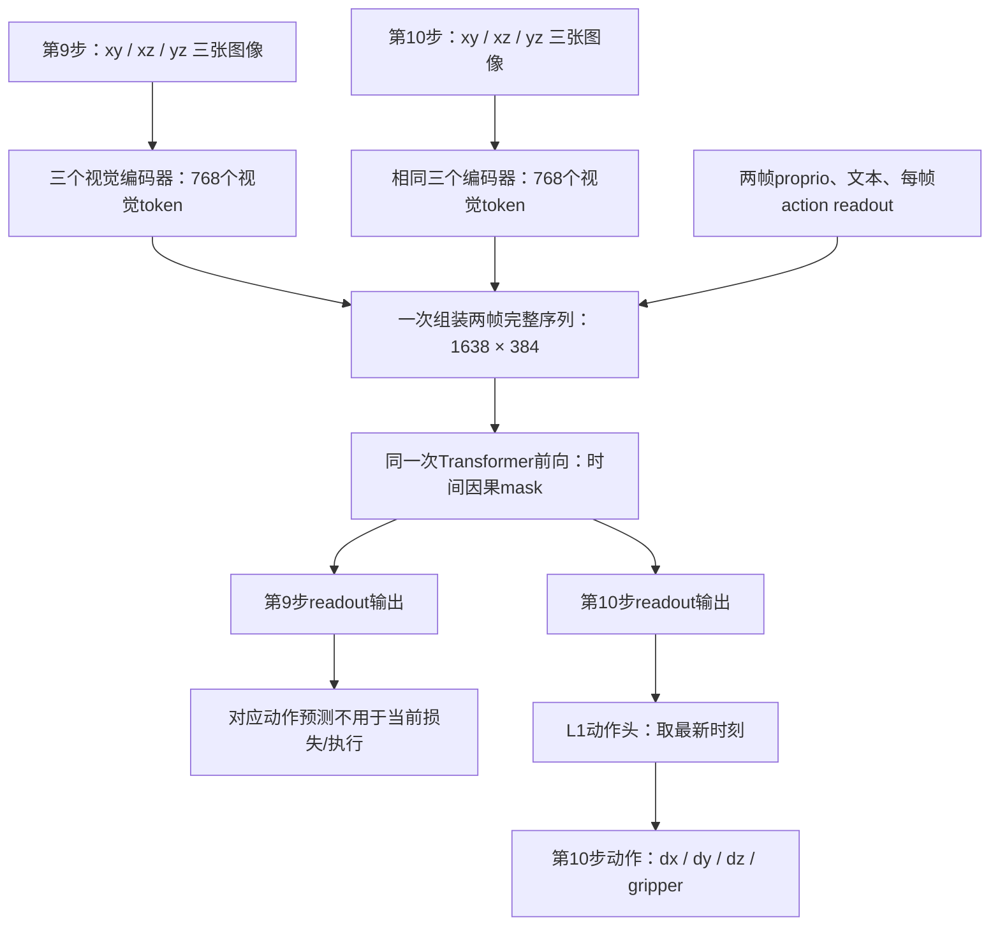
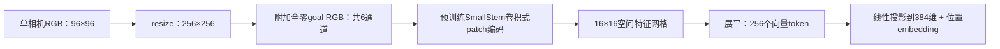
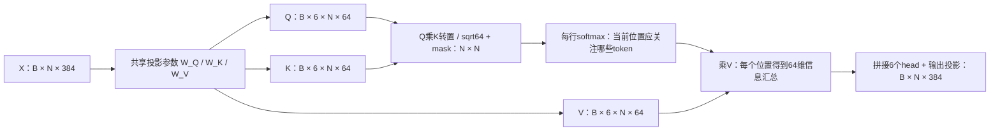

# Octo 三视角 Pick-Place：PyTorch 行为克隆

训练、数据加载、梯度、优化器、保存恢复和仿真策略推理均使用 **PyTorch**。
仅 `convert` 一次性读取原始 JAX/Orbax 格式的预训练权重；`train` 和
`evaluate` 只读取原生 `.pt` 检查点，不导入 JAX、Flax 或 TensorFlow。
TensorBoard 使用自身的 lightweight compatibility stub，不启动 TensorFlow。

## 环境和运行方式

在仓库根目录运行，使用已有的 Python 3.11 `octo_pt`：

```bash
conda activate octo_pt
python -m pip check
python -m pip install --no-deps -e .
```

只有缺少额外依赖时才运行：

```bash
python -m pip install -r robot_arm/octo/requirements.txt
```

不需要重新安装 torch、torchvision、torchaudio。不要无约束升级 Accelerate、
Transformers、Hugging Face Hub；额外包安装使用根目录 `requirements.txt` 的约束。
安装 editable 包后，各入口可从任意工作目录以 `python -m` 调用。

## 1. 一次性转换

```bash
python -m robot_arm.octo.convert
```

默认读取 `hf://rail-berkeley/octo-small-1.5`，生成
`robot_arm/octo/checkpoints/base.pt` 和 `base.report.json`。
`--pretrained` 可指定下载好的本地 JAX 检查点目录，`--output` 可指定输出。
转换检查核心预训练权重不能缺失；语言 T5 从独立的 HF 预训练模型加载并复制，
其权重不会因 Octo 转换报告中的 `hf_model` 警告变成随机初始化。

默认专家路径是 `robot_arm/expert_showcase_v4`。转换会完整校验数据并保存文件内容
校验和、数据划分、动作统计和固定任务文本。数据发生变化后需要重新转换，
不能沿用旧的训练统计或恢复训练。

## 2. 正式微调

```bash
OCTO_TORCH_ONLY=1 python -m robot_arm.octo.train \
  --run-id pick_place_v1 --device cuda
```

`OCTO_TORCH_ONLY=1` 对真实的 JAX/TF/Flax 导入施加硬性禁止，用于证明训练链路只用
PyTorch；兼容 Torch 等包通过 `find_spec` 检测可选依赖，不伪造这些后端模块。
原生训练及评估不需要网络，也不会重新下载 T5。

默认设置：
- 1,203 条成功轨迹，按 episode、seed=42 划分为 1,082 条训练 / 121 条验证；
  92 条失败轨迹仅保存为诊断划分，不进入行为克隆训练。
- batch=4，梯度累积=8，有效 batch=32；AdamW、lr=3e-5、warmup=500、
  gradient clip=1.0，共 10,000 次 optimizer 更新；CUDA FP16 AMP，CPU FP32。
- 默认开启学习率衰减：预热后保持基础 lr 至第 5000 次更新，然后余弦衰减，
  第 10000 次更新达到 `3e-6`，之后保持最低值。`--no-lr-decay` 关闭衰减，
  `--lr-decay` 显式开启；`--decay-start 5000 --decay-end 10000 --min-lr-ratio 0.1`
  可调整边界和最低比例。边界独立于 `--steps`，延长训练不会重新拉伸衰减曲线。
- 冻结 T5，训练三视角图像编码器、Transformer、proprio 模块及 4 维 L1 动作头。
- 五阶段等概率采样训练步骤，验证保持原始分布。阶段不进入策略观测。
- `--sampling balanced` 为默认阶段均衡采样；`--sampling random` 按训练集所有
  transition 均匀随机采样。两者都采用有放回抽样，不是按轨迹等概率抽样。
- 每 500 步验证，每 1,000 步保存和评估 20 条独立 seed 的完整仿真轨迹，
  最后一步也验证、保存和评估。

所有默认路径按源码位置解析：
- TensorBoard：`robot_arm/tb_logs/octo/<run_id>/`
- 模型：`robot_arm/octo/checkpoints/<run_id>/`

GPU 显存不足时减小 `--batch-size`、增大 `--accumulation`，保持有效 batch。
FP16 遇到非有限 loss 或梯度时丢弃整组累积梯度、降低 AMP scale，并重新采样。
跳过的更新不推进 optimizer、学习率或训练步数；TensorBoard 记录 `train/amp_scale`
和累计 `train/skipped_updates`。连续 10 次失败会保存 `latest.pt` 并停止，避免无限重试。
FP32 非有限数值仍然报错。恢复训练必须保留原有 AMP 设置。
没有 CUDA 时显式用 `--device cpu`，但正式训练和大规模评估会比较慢。
日志包括训练/验证 L1、逐动作维度和阶段验证误差、学习率、梯度范数、吞吐量、
CUDA 显存、仿真成功率、回报、长度、阶段到达率及失败原因。

```bash
tensorboard --logdir robot_arm/tb_logs/octo
```

这是 IL/行为克隆，不是 SAC 或离线 RL；五阶段奖励保持原样，用于仿真评估，
而不是加入行为克隆损失。少量冒烟训练不可能代表最终成功率。

## 3. 恢复和评估

```bash
OCTO_TORCH_ONLY=1 python -m robot_arm.octo.train \
  --resume robot_arm/octo/checkpoints/pick_place_v1/latest.pt \
  --device cuda --steps 20000

OCTO_TORCH_ONLY=1 python -m robot_arm.octo.evaluate \
  --checkpoint robot_arm/octo/checkpoints/pick_place_v1/best_success.pt \
  --episodes 100 --device cuda
```

`--steps` 是总 optimizer 步数，不是新增步数。恢复继承 batch、梯度累积、lr、warmup、
衰减设置和采样模式，不允许更改这些参数或 AMP/device 类型；可增加总步数。
旧版检查点缺少新设置时恢复为“不衰减 + 阶段均衡”，不会自动启用新默认值。
消融实验应从同一个 `base.pt` 开始新运行，不使用 `--resume` 切换实验条件。
保存优化器、scheduler、
scaler、随机状态、采样器状态和数据划分。默认沿用 run-id。

检查点包含 `latest.pt`、`best_validation.pt`、`best_success.pt`；
若 `--eval-episodes 0`，不产生 `best_success.pt`。
独立评估输出同名 `.evaluation.json`，默认 100 个 seed 从 100000 起，
可加 `--gui`。仅加载自己生成且信任的 `.pt` 文件。

四组消融训练（每次训练中的评估仍默认 20 个固定独立 seed）：

```bash
python -m robot_arm.octo.train --run-id decay_balanced --lr-decay --sampling balanced --device cuda
python -m robot_arm.octo.train --run-id constant_balanced --no-lr-decay --sampling balanced --device cuda
python -m robot_arm.octo.train --run-id decay_random --lr-decay --sampling random --device cuda
python -m robot_arm.octo.train --run-id constant_random --no-lr-decay --sampling random --device cuda
```

以上命令分别执行，不要同时启动四组训练。配置写入运行目录的 `config.json` 和检查点。
TensorBoard 的 `train/lr` 在 scheduler 更新后记录，表示下一次参数更新所使用的学习率。

评估不改变 PixelTaskEnv 的五阶段奖励、超时、成功条件和动作定义。
策略只看到三视角 RGB 和 26 维 proprio，不看到阶段、物体/目标坐标或成功标志。
动作每步重新预测，逆归一化后裁剪至 `[-1,1]`。

## 数据与模型细节

- 数据形状 `(T,18,96,96)` 拆为两个历史时刻，每个时刻按 **xy/xz/yz** 排列；
  代码里的真实顺序是这个顺序，不是目录描述里的 xy/yz/xz。
- 数据逐行对应动作执行前观测。历史按旧帧→当前帧排列，首步重复初始帧；
  每条轨迹均检查相邻图像历史重叠关系。proprio 的前一帧只从同一条轨迹读取。
- 每个视图保持独立 RGB，resize 为 256×256；像素保持 `0..255` 浮点值，
  由 Octo 预训练视觉编码器内部归一化为 `[-1,1]`，避免二次归一化。
- 原始视觉 stem 需要“观测 RGB + goal RGB”六通道输入。为保持预训练权重形状，
  给每个视图附加全零的 goal 图像，不输入真实目标图像、目标坐标或额外相机数据。
  三个视图的 stem、projection 和位置 embedding 均复制 primary 的兼容权重。
- 26 维 proprio 已由环境归一化；使用项目 PyTorch low-dimensional bin tokenizer。
  动作仅使用训练集逐维均值/标准差归一化。动作头 horizon=1，输出 4 维。
- 文本固定为 “Pick up the red block and place it at the green target.”；
  冻结 T5 并保持 eval 模式，训练不会更新其权重。

## 输入输出适配：从六张图像到一次动作

### 一次预测到底输入和输出什么？

以 episode A 的第 10 步为例，一次前向同时输入第 9、10 步各三个相机的图像、
两个时刻的 26 维 proprio，以及固定任务文本。输出用于执行的第 10 步动作
`[dx, dy, dz, gripper]`。当前 L1 回归头直接预测动作向量，不输出动作概率分布。



图中的 token 数是序列长度，384 是每个 token 的向量维度；不是每个 token 只有一个数。
不同样本位于 batch 维，不会互相 attention。

### 每张图像如何 tokenize？



文本 token 通常先得到离散词表编号，再查 embedding 表；图像直接通过视觉编码器
得到连续特征向量，无需查“图像词表”。线性投影将特征对齐到 Transformer 的 384 维。

SmallStem 是卷积式 patch 编码器：逐步提取特征并降低空间分辨率，最后产生空间网格。
它不是标准 ViT 的“直接切分不重叠像素块再投影”，但也不应理解为完全没有 patch 化；
卷积感受野会重叠，一个 token 不严格局限于原图中的一个独立 16×16 小块。
ViT 本身也没有“固定分9块”的规定，token 数取决于图像尺寸和 patch 大小。

三个相机各产生 256 个 token，每个时刻合计 768 个视觉 token。三个视觉分支的参数
最初复制自同一个预训练 primary 分支，随后独立更新；同一相机在两个时间步之间
共享编码器参数。不同分支具有各自的投影和位置 embedding，最初也复制 primary 的兼容参数。

### frame stack=2 的实际形状和序列长度

下表用 `B` 表示 batch size。形状对应当前转换后的 Octo-small 配置：

| 内容 | 形状/数量 | 含义 |
|---|---|---|
| 每个相机图像输入 | `(B, 2, 3, 256, 256)` | 两帧，每帧 RGB；补零 goal 后内部为6通道 |
| 每个相机投影后的 token | `(B, 2, 256, 384)` | 每帧256个区域向量 |
| 三相机视觉 token 总数 | `2 × 768 = 1536` | 两帧六张图像 |
| proprio token | 每帧26个，投影后各384维 | 来自已归一化的机器人自身状态 |
| 文本 token | 前缀16个；每帧再重复16个 | 当前 `repeat_task_tokens=True`；数量含padding槽位 |
| action readout | 每帧1个，384维 | 用于汇总动作信息的查询位置 |
| Transformer 完整输入 | `(B, 1638, 384)` | `16 + 2 × (768 + 26 + 16 + 1)` |
| 动作头完整输出 | `(B, 2, 1, 4)` | 两个时刻、单步horizon、4维动作 |
| 实际使用的预测 | `(B, 4)` | `[:, -1, 0]` 只取当前时刻 |

因此，self-attention 一次处理两帧的完整序列，而不是先单独处理768个视觉 token，
再处理下一帧。每层的逻辑 attention 矩阵覆盖完整的1638个序列位置，并应用mask。
这里的1638包含重复文本 token；如果配置关闭文本重复，才会变成1606。

训练时，仅最新时刻的动作预测与对应专家动作计算 L1；旧时刻的观测仍参与历史特征
计算并影响当前预测。`frame stack=2` 不表示预测两个未来动作，也不表示同一动作执行两次。

### 预训练 self-attention 为什么能接收更多 token？Q/K/V 有多大？

关键是区分**可学习的投影参数 W_Q/W_K/W_V**与**本次输入计算得到的 Q/K/V 张量**。
Q/K/V 本身不是三份固定的模型参数，而是随输入变化的中间特征；投影参数在训练中学习，
同一层对所有 token 共享这些参数。不同 Transformer 层有各自的投影参数。

设 batch size 为 B，序列长度为 N，embedding 维度为 D。忽略 bias，数学表达为：

```text
X:             (B, N, D)
W_Q/W_K/W_V:    (D, D)                 ← 可学习参数，与 N 无关
Q = X @ W_Q:   (B, N, D)               ← 本次前向计算结果，随 N 变化
K = X @ W_K:   (B, N, D)
V = X @ W_V:   (B, N, D)
```

类比普通 Linear(D, D)：不管输入10个还是100个向量，都可以对每个向量使用同一组线性参数。
不是为每个序列位置单独保存一套 Q/K/V 投影权重。

本项目 Octo-small 的 D=384、head数 H=6，每个 head 的维度 d=64，实际形状如下：

| 对象 | 当前形状 | 是否依赖输入长度 N |
|---|---|---|
| 每层 W_Q、W_K、W_V | 各 `(384, 384)` | 否 |
| 三份 bias | 各 `(384,)` | 否 |
| PyTorch `in_proj_weight` | `(1152, 384)`，合并存储三个投影 | 否 |
| PyTorch `in_proj_bias` | `(1152,)` | 否 |
| Q/K/V，拆 head 前 | 各 `(B, N, 384)` | 是 |
| Q/K/V，拆 head 后 | 各 `(B, 6, N, 64)` | 是 |
| 每个 head 的 attention 分数 | `(B, 6, N, N)` | 是 |
| attention 输出，合并 head 后 | `(B, N, 384)` | 是 |
| 输出投影 `out_proj.weight` | `(384, 384)` | 否 |

表中参数形状已核对本地转换后的检查点。PyTorch Linear 存储的是数学表达中权重的转置，
即实际计算 `X @ weight.T + bias`；本例方阵的形状不受转置影响。



因此，输入长度从较短序列变成当前 N=1638，不要求改变预训练 attention 的投影参数。
变化的是本次计算的 Q/K/V 行数，以及各 token 两两交互的 attention 矩阵。
每层仍为所有1638个位置输出384维向量；动作头之后才读取当前 action readout 位置。

不过，“attention 支持变长”不等于“整个预训练模型可以无条件接受任意输入”：

- embedding 维度必须匹配384，head划分也必须匹配；新增模态要先投影到相同维度。
- 本模型的可学习位置 embedding 依赖相机分支、空间 token 数和时间窗口，需要对应配置。
  `convert.py` 为新视角复制这些参数并配置两帧窗口；不能只往现有输入里随意增加相机或历史帧。
- attention mask、padding 和 readout 组织必须同步匹配新序列；同一个 batch 通常通过padding对齐长度。
- 标准 attention 的两两交互计算量随 N 平方增长，序列长度翻倍会使这部分开销约变为4倍；
  实际峰值显存还受后端是否显式保存 attention 矩阵等实现影响。
- 参数形状兼容不保证新输入分布下的任务效果，因此三视角和新动作空间仍需专家数据微调。

### 三个相机的排列会变成时间先后吗？

不会。时间由 timestep 和 attention mask 决定，不由相机在序列中的排列决定：

- 同一时刻的 xy/xz/yz 和 proprio 观测 token 可以互相关注。
- 当前时刻的观测可关注上一时刻的观测；上一时刻不能看当前时刻。
- 文本前缀只关注任务 token；观测不关注 readout，readout 按规则读取当前及历史观测。
- 各相机的位置 embedding 区分视角、空间位置和历史时刻；模型不天然具有相机置换不变性，
  必须保持图像与 `image_xy/image_xz/image_yz` 的对应关系，不能错误互换。

这是一种按时间和token组限制信息流的 mask，不是简单按整个序列位置做逐token下三角遮挡。

### 样本之间是否连续？

训练样本之间随机抽取，不要求时间连续；每个样本内部的两帧必须来自同一episode且连续：

```text
样本1：episode A [第9步, 第10步]   → 专家第10步动作
样本2：episode B [第19步, 第20步]  → 专家第20步动作
样本3：episode A [第3步, 第4步]    → 专家第4步动作
```

模型没有把上一个训练样本的隐藏状态传给下一个样本。阶段均衡/随机采样只改变样本
被抽取的概率，不改变样本内部的时序组织。首步重复初始观测，避免跨episode读取历史。

实际在线执行时，窗口随环境连续滑动：`[9,10] → 动作10`，执行后变为
`[10,11] → 动作11`，每一步都重新输入完整的两帧窗口。

### 从代码哪里开始读？

| 路径 | 职责 |
|---|---|
| [convert.py](convert.py) | 加载HF原始权重；创建三视角、proprio、新动作头，复制兼容参数并保存base.pt |
| [runtime.py](runtime.py) 的 `load_checkpoint` | 根据适配配置重建模型，`load_state_dict` 装入本地权重并冻结T5 |
| [data.py](data.py) 的 `ExpertDataset` / `observation_tensors` | 同episode两帧对齐、三视角拆分、resize、专家动作归一化 |
| [train.py](train.py) | 抽取独立样本、预测最新动作、计算专家监督L1并更新参数 |
| [evaluate.py](evaluate.py) 的 `predict` / `rollout` | `[:, -1, 0]` 选择当前动作，逆归一化后交给环境 |
| [octo_module_pt.py](../../octo/model/octo_module_pt.py) | 组装文本、观测、readout token，添加位置embedding和attention规则 |

五阶段任务逻辑和奖励保留在环境中；阶段标签用于采样/统计，奖励用于仿真评估。
当前微调通过专家动作监督学习该任务，不使用奖励进行RL更新。

## 冒烟验收

```bash
OCTO_TORCH_ONLY=1 python -m unittest discover -s robot_arm/octo/tests -v

OCTO_TORCH_ONLY=1 python -m robot_arm.octo.train \
  --run-id smoke --device cpu --steps 5 --batch-size 1 --accumulation 1 \
  --validation-batches 2 --eval-episodes 0

OCTO_TORCH_ONLY=1 python -m robot_arm.octo.train \
  --resume robot_arm/octo/checkpoints/smoke/latest.pt --device cpu \
  --steps 6 --validation-batches 2 --eval-episodes 0

OCTO_TORCH_ONLY=1 python -m robot_arm.octo.evaluate \
  --checkpoint robot_arm/octo/checkpoints/smoke/latest.pt --device cpu --episodes 2
```

`--validation-batches` 和 `--eval-max-steps` 是快速诊断选项；正式训练保留默认的
完整验证和 150-step episode。CPU 冒烟结果不能验证 GPU AMP 性能。

### 当前环境验收结果

- 12 项测试通过，包括旧/新 attention 规则的向量化等价性、五阶段奖励和超时回归、
  数据历史/动作对齐、禁止后端导入及原生检查点重载一致性。
- CPU 完成 5 次优化更新并成功恢复至第 6 步；T5 无梯度，视觉/Transformer/动作头有梯度。
- RTX 4070 Laptop 8GB 上完成 batch=4、accumulation=1 的 5 次 FP16 更新，
  PyTorch 峰值分配约 4160 MiB，TensorBoard event 已验证。
- CUDA 训练后的两条完整 headless rollout 均正常结束：各 100 步 approach timeout，
  成功率 0%。这是仅 5 步训练的链路冒烟检查，不是已经学会任务的 agent。
- 已生成 `checkpoints/base.pt`、`checkpoints/smoke/`、`checkpoints/smoke_cuda/`
  和对应 TensorBoard 日志；未启动正式长期训练。
